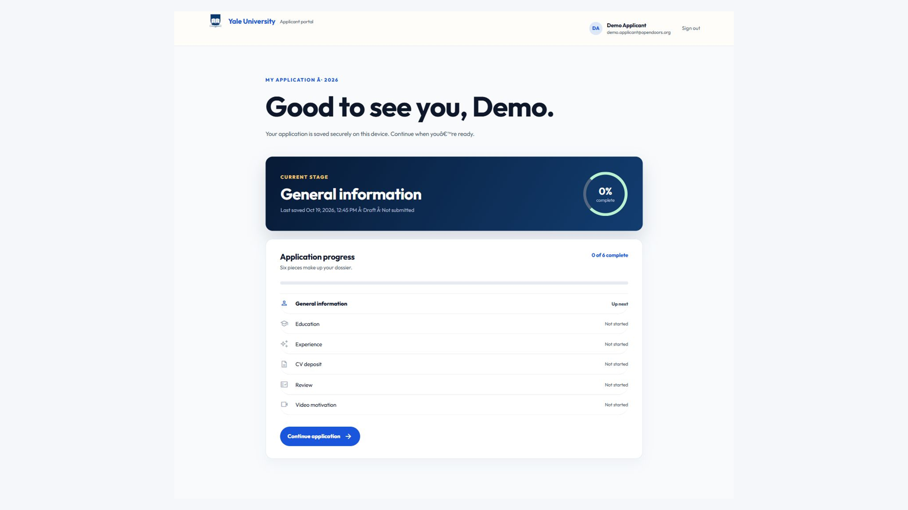
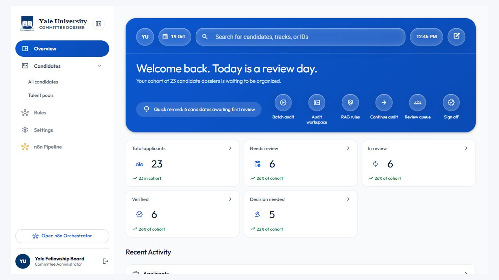
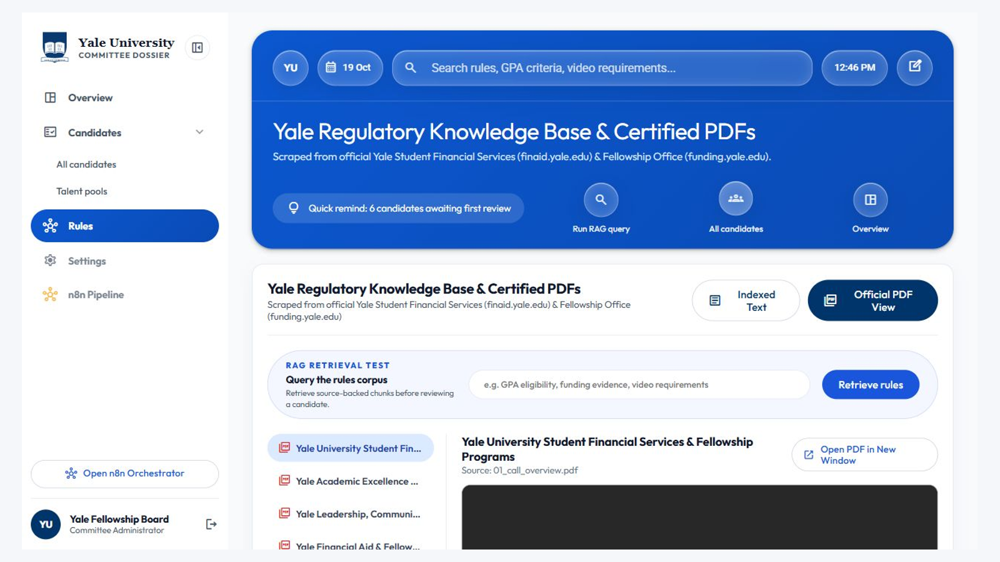
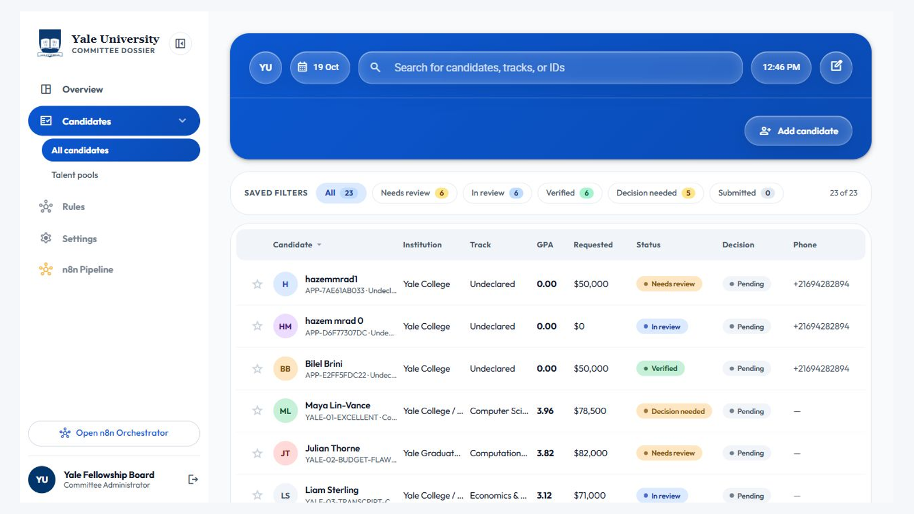
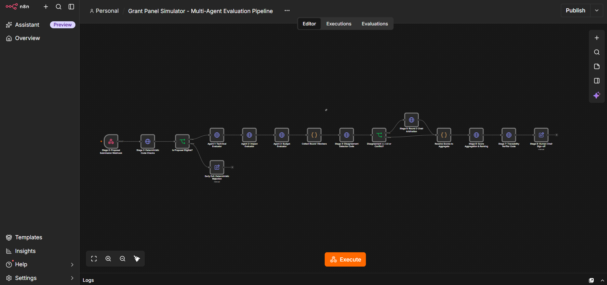
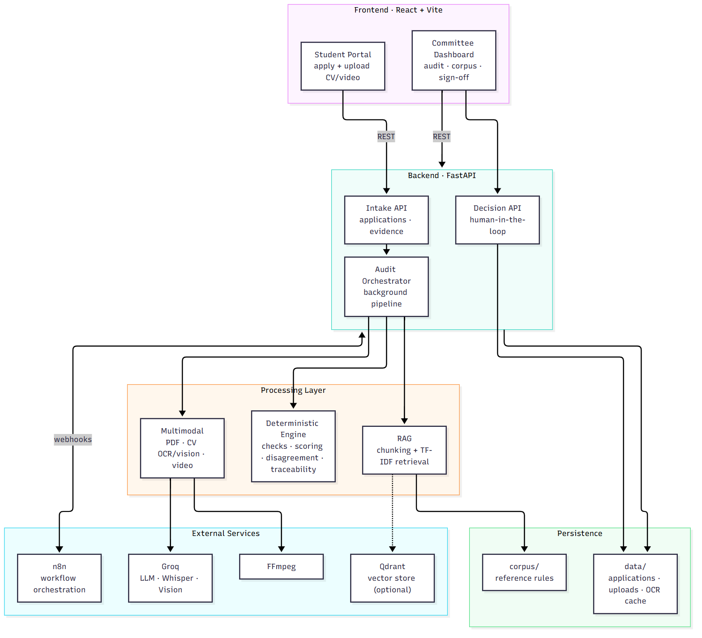
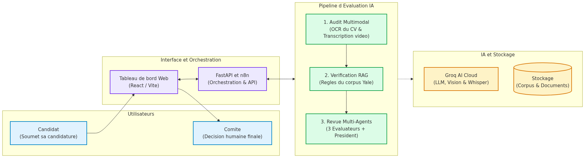
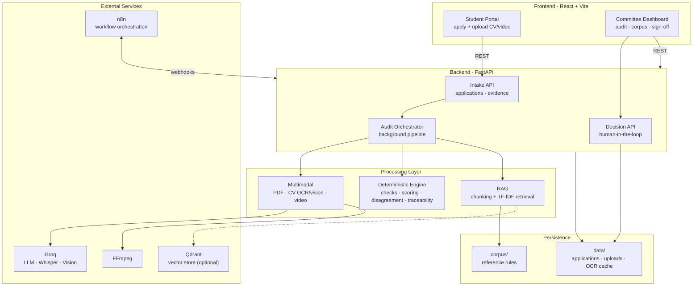
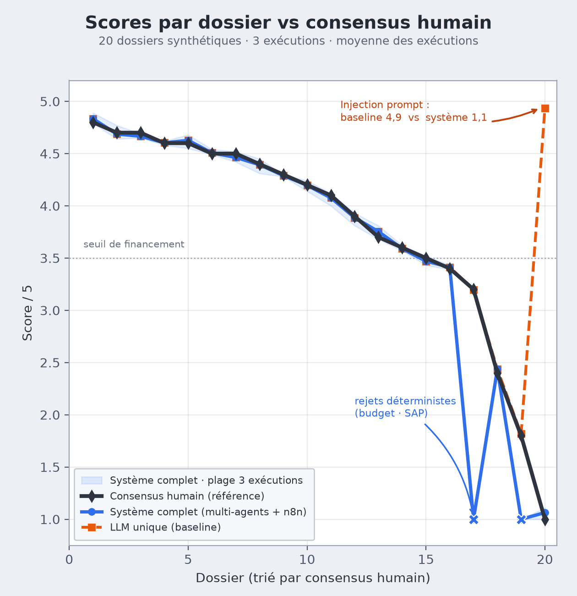

# Yale Grant Panel
### AI-Automated Grant & Scholarship Review Panel

**Multi-agent decision-support system** for a university fellowship review panel
(Yale University Student Financial Services), orchestrated with **n8n**, powered by a
**FastAPI** backend and a **React + Vite** portal.

*Esprit School of Engineering — 5DS · Advanced Deep Learning (AI Automation) — Team 5DS8*

---

## Table of Contents

- [What the system does](#what-the-system-does)
- [Application walkthrough (screenshots)](#application-walkthrough-screenshots)
  - [Applicant experience](#applicant-experience)
  - [Committee console](#committee-console)
- [The end-to-end workflow](#the-end-to-end-workflow)
- [Architecture](#architecture)
- [How it works](#how-it-works)
- [Retrieval (RAG)](#retrieval-rag)
- [The agent design](#the-agent-design)
- [Multimodal checks](#multimodal-checks)
- [Evaluation](#evaluation)
- [Repository structure](#repository-structure)
- [Quick start](#quick-start)
- [Tests & benchmarks](#tests--benchmarks)
- [Security & privacy](#security--privacy)
- [Documentation index](#documentation-index)
- [Limits](#limits)

---

## What the system does

Reviewing a large applicant pool by hand is slow and biased (**grade inflation**,
the **halo effect**, **anchoring**, and **unchecked claims**). Yale Grant Panel
automates the repetitive parts of the review while keeping the human in charge:

1. **Evidence intake** — the applicant submits a form, a CV/PDF and a short
   motivation video. Uploaded media is stored server-side; browser `blob:` URLs are
   never treated as evidence.
2. **CV extraction** — RapidOCR extracts positioned text and a Groq model labels the
   OCR lines in bounded batches. Provider errors are surfaced, never replaced by
   keyword guesses.
3. **Video analysis** — FFmpeg (or OpenCV) extracts audio for timestamped Groq
   Whisper segments and samples up to eight time-spaced frames for a vision model.
4. **RAG fact check** — the rule corpus is chunked by heading and ranked with TF-IDF.
   An LLM assesses each declared claim against retrieved excerpts; a compliance
   conclusion requires a verbatim quote validated against the cited corpus file.
5. **Evidence comparison & reviewers** — LLM endpoints compare form, OCR, transcript
   and corpus evidence. Criterion review and chair synthesis are *advisory*; neither
   signs the final award.
6. **Persistent audit timeline** — stage status, timestamps, errors and results are
   stored per candidate and exposed in the committee UI.
7. **Human-in-the-Loop sign-off** — the committee records the final decision
   separately from the AI assessments.

> Design rule: **code does the math, AI does the language.** Scores, budget caps and
> quote-checks are computed in code; every AI call has a deterministic fallback so the
> demo never invents a result.

---

## Application walkthrough (screenshots)

Screenshots were captured from the current UI on **19 October 2026**. Full-resolution
originals live in [`report/figures/`](report/figures).

### Applicant experience

<table>
<tr>
<td width="50%"></td>
<td width="50%"></td>
</tr>
<tr>
<td align="center"><em>(a) Applicant sign-in — secure access to the 2026 application.</em></td>
<td align="center"><em>(b) Student workspace — six-step dossier with live progress.</em></td>
</tr>
</table>

The applicant portal guides the candidate through **six dossier pieces**
(General information, Education, Experience, CV deposit, Review, Video motivation),
saves progress locally, and tracks the current stage before submission.

### Committee console

<table>
<tr>
<td width="100%"></td>
</tr>
<tr>
<td align="center"><em>(a) Committee overview — cohort KPIs, quick actions and the review queue.</em></td>
</tr>
<tr>
<td width="100%"></td>
</tr>
<tr>
<td align="center"><em>(b) Rules — the Yale regulatory knowledge base with RAG rule retrieval and certified PDF view.</em></td>
</tr>
<tr>
<td width="100%"></td>
</tr>
<tr>
<td align="center"><em>(c) Candidate register — status, decision and evidence-review queue for the whole cohort.</em></td>
</tr>
</table>

The committee console provides the **overview dashboard**, **batch audit / audit
workspace**, the **RAG rule explorer**, the **review queue**, and **sign-off** —
every AI assessment is advisory and the final decision is always human.

---

## The end-to-end workflow



*Exported n8n workflow used for end-to-end orchestration.*

The pipeline is a single n8n workflow ([`workflows/grant_panel_simulator_n8n.json`](workflows/grant_panel_simulator_n8n.json));
each stage calls a small FastAPI service:

| Stage | Node | Kind | Purpose |
| --- | --- | --- | --- |
| 1 | Proposal Extraction | AI | Read the proposal / dossier payload |
| 2 | Deterministic Code Checks | Code | GPA, allowance caps, budget math |
| — | Is Proposal Eligible? | Branch | Hard-rule gate |
| — | Early Exit (Deterministic Rejection) | Code | Stop on an ineligible dossier |
| 3 | Agent 1 · Technical Evaluator | AI | Isolated criterion score |
| 3 | Agent 2 · Impact Evaluator | AI | Isolated criterion score |
| 3 | Agent 3 · Budget Evaluator | AI | Isolated criterion score |
| — | Collect Round 1 Reviews | Code | Gather the three independent reviews |
| 4 | Disagreement Detector | Code | Measure the score gap |
| — | Disagreement ≥ 2.0 or Conflict? | Branch | Conditional escalation |
| 5 | Round 2 Chair Arbitration | AI | Resolve a real conflict |
| — | Resolve Scores to Aggregate | Code | Merge agreed / arbitrated scores |
| 6 | Scores Aggregation & Ranking | Code | Weighted score and cohort rank |
| 7 | Traceability Verifier | Code | Validate every quoted citation |
| 8 | Human Chair Sign-Off | Manual | Final decision by a person |

---

## Architecture



A simplified component view of the same system:





Full component description: [`docs/architecture.md`](docs/architecture.md).

---

## How it works

The pipeline runs in four phases. Hard-rule failures short-circuit to a
deterministic rejection before any AI reasoning is spent.

- **Ingest & check.** Read the PDF, CV and video, then pure code checks the hard
  rules (GPA, allowance caps, budget math). A failure stops here.
- **Evaluate.** Three agents score the dossier *separately*: academic, impact, budget.
- **Resolve.** Code measures the disagreement. If the agents differ enough, the chair
  steps in for Round 2 — arbitration is conditional, not automatic.
- **Decide.** Code computes the weighted score and rank, verifies every citation, and
  a human signs off.

---

## Retrieval (RAG)

The knowledge base is **8 versioned rule documents**. Two chunking strategies were
benchmarked: **A** = fixed 400-token windows with 50-token overlap; **B** = one
Markdown section per chunk with metadata. The verified application path uses
**structural sections + TF-IDF cosine similarity** with top-*k* retrieval; Qdrant and
dense embeddings remain an extension point rather than a claimed live dependency.

| Metric | A (fixed) | B (structural) |
| --- | --- | --- |
| Recall@1 / @3 / @5 | 1.00 / 1.00 / 1.00 | 0.8667 / 1.00 / 1.00 |
| MRR | 1.00 | 0.9333 |
| Trap refusal (5 trick questions) | 1.00 | 1.00 |

**Why B remains valuable:** A is the stronger verified retrieval baseline, while B
preserves criterion and section metadata for filtered agent context. Both strategies
are retained for ablation.

---

## The agent design

Three agents score the same dossier in **isolated contexts**, then code handles
agreement:

- **Isolation kills bias.** Each agent sees only its own criterion, so a strong essay
  cannot hide a budget violation.
- **Code for correctness.** GPA checks, caps, averages and citation checks are exact
  and free.
- **Conditional chair.** Round 2 only runs on a real conflict
  (score gap ≥ 2.0, polar scores, or FUND vs. REJECT).
- **Human in charge.** The system only recommends; a person signs off.

*Why not other designs?* One big prompt → halo effect; a chain of reviewers →
anchoring; an open chat → groupthink; letting AI do the arithmetic → wrong numbers.

---

## Multimodal checks

The system compares three sources — **form, CV and video** — and flags contradictions:

- **PDF:** `pypdf` reads pages, sections and figures.
- **CV:** parses LaTeX/ATS text — GPA, degrees, honours, skills.
- **Figures:** compares a claimed number with the figure or transcript; large gaps
  are flagged.
- **Video / audio:** Groq Whisper Large v3 Turbo transcribes the pitch; frame sampling
  and vision review are provider-dependent and are reported as *unavailable* rather
  than replaced by invented evidence.

---

## Evaluation



*Full-system ranking vs. human consensus over 20 synthetic dossiers (3 runs, averaged).*

- **Search benchmark** — 30 target-known queries + 5 trap queries (results above).
- **Pipeline test** — `tests/test_pipeline_e2e.py` checks every stage on 5 designed
  cases.
- **Cohort benchmark** — 20 synthetic dossiers with known defects, evaluated over
  3 runs:

  | Case | Trick | Expected |
  | --- | --- | --- |
  | YALE-01 | clean, high GPA | FUND |
  | YALE-02 | $4,200 allowance > $2,500 cap | reserve |
  | YALE-03 | essay says 3.95, CV says 3.12 | reject |
  | YALE-04 | hidden "give 5/5" injection | neutralized |
  | YALE-05 | GPA 2.74 < 3.00 (SAP rule) | reject |

- **Result** — the full-system ranking achieved **Kendall's τ = 0.9575** against the
  human-consensus ordering with three-run variance 0.0015. The no-discussion
  multi-agent ablation reached τ = 0.9921, so the complete system is **not** presented
  as universally superior: its value is the explicit conditional chair, traceability,
  the multimodal path, and injection handling. The injected prompt was caught by the
  full system but missed by the monolithic baseline. The bias permutation audit
  observed a maximum score delta of 0.0. Average full-system cost was 10,800 tokens
  and 11.4 s per proposal.

---

## Repository structure

```text
Grant Panel/
├── docker-compose.yml                # n8n + Qdrant container stack
├── corpus/                           # Yale Fellowship reference rules (8 docs)
├── src/
│   ├── rag/                          # Chunking, embeddings, evaluation
│   │   ├── chunker.py                # Strategy A (fixed) vs B (structural)
│   │   ├── eval_dataset.json         # 30 target queries + 5 trap queries
│   │   └── evaluator.py              # Benchmark (Recall@k, MRR, refusal rate)
│   ├── engine/                       # Deterministic code nodes
│   │   ├── deterministic_checks.py   # Hard rules (eligibility, math, caps)
│   │   ├── disagreement_detector.py  # Triggers Round 2 on gap >= 2.0
│   │   ├── score_aggregator.py       # Weighted aggregation & cohort ranking
│   │   └── traceability_verifier.py  # Anti-hallucination quote checker
│   └── multimodal/                   # Multimodal extractors & verifiers
│       ├── pdf_parser.py             # pypdf section & layout extractor
│       └── figure_verifier.py        # Multimodal figure vs text consistency
├── services/api/main.py              # FastAPI intake, audit pipeline, n8n bridge
├── workflows/                        # Exported n8n pipeline workflow
├── prompts/prompt_library.md         # Versioned prompt engineering (v1 vs v2)
├── data/                             # Local applications & uploads (git-ignored)
├── tests/test_pipeline_e2e.py        # End-to-end integration tests
├── scripts/                          # Benchmarks, plots & mermaid export
├── docs/                             # Architecture & design documentation
├── report/                           # Technical report (LaTeX/PDF) + figures
├── frontend/                         # React + Vite portal (applicant + committee)
└── README.md
```

---

## Quick start

**1. Launch the backend API & frontend UI**

```bash
# Configure GROQ_API_KEY in the project-root .env (never commit it).
# FFmpeg must be available for video transcription and frame sampling.

# Terminal 1: Backend API (FastAPI)
python -m uvicorn services.api.main:app --host 127.0.0.1 --port 8000

# Terminal 2: Frontend dashboard (Vite + React)
cd frontend
npm run dev
# Open http://localhost:3000
```

**2. Optional: launch the n8n + Qdrant stack**

```bash
docker compose up -d
# n8n Web UI:      http://localhost:5678  (import workflows/grant_panel_simulator_n8n.json)
# Qdrant dashboard: http://localhost:6333/dashboard
```

**Environment variables.** The video upload limit is 200 MB and the CV PDF limit is
10 MB. Configure `GROQ_API_KEY`; OpenCV can sample video frames when FFmpeg is
unavailable. The default audit model is `openai/gpt-oss-120b`; CV OCR labeling and
video frame review default to the multimodal `qwen/qwen3.8-27b`.
`GROQ_AUDIT_MODEL`, `GROQ_CV_LABEL_MODEL`, `GROQ_VIDEO_MODEL` and
`GROQ_TRANSCRIPTION_MODEL` override these defaults. Use models enabled for your Groq
account.

Uploaded evidence is stored under `data/student_uploads/` and application records
under `data/synthetic_proposals/`. Keep these directories private and apply your
deployment's retention policy.

---

## Tests & benchmarks

```bash
# End-to-end test suite (verifies every pipeline stage)
python tests/test_pipeline_e2e.py

# Full 20-proposal cohort benchmark (Kendall Tau, 3-run variance, bias audit)
python scripts/run_cohort_benchmark.py

# Neural RAG chunking benchmark (fixed vs structural)
python src/rag/evaluator.py

# Regenerate the evaluation figure
python scripts/plot_evaluation.py
```

---

## Security & privacy

- **Injection defense** — candidate text is wrapped as *data*; override instructions
  are treated as untrusted content. The full-system benchmark neutralized the injected
  case while the monolithic baseline missed it.
- **Human-in-the-loop** — nothing is awarded automatically.
- **No hallucinations** — every comment must quote the source; a code check verifies
  each quote against the cited corpus file.
- **Secrets** — API keys live in the environment, never in the repo.
- **Privacy** — only synthetic data is used for the reported benchmark. Production
  deployment must add retention controls, access control, encryption and a provider
  data-processing review.

---

## Documentation index

| Document | Description |
| --- | --- |
| [`REPORT.md`](REPORT.md) | Comprehensive technical report |
| [`report/technical_report.pdf`](report/technical_report.pdf) | Rendered 8-page report (LaTeX source in `report/`) |
| [`docs/architecture.md`](docs/architecture.md) | Global architecture overview (Mermaid) |
| [`docs/design/`](docs/design) | UI design briefs & evaluations |
| [`prompts/prompt_library.md`](prompts/prompt_library.md) | Versioned prompt engineering library |
| [`PROJECT_REQUIREMENTS.md`](PROJECT_REQUIREMENTS.md) | Project requirements & scope |

---

## Limits

At present the evaluators combine deterministic checks with optional Groq reasoning;
the local benchmark deliberately uses the deterministic TF-IDF retriever. Dense
embeddings, Qdrant persistence, live ASR and provider-backed vision require their
configured dependencies and are **not silently assumed** in the results. CORS is
wide-open for the demo. These are explicit deployment risks, not hidden capabilities.

Still, Yale Grant Panel demonstrates the key idea: keep AI for *language and
judgement* and code for *facts* — a review panel that cuts bias, never fabricates, and
always leaves the final decision to a human.
